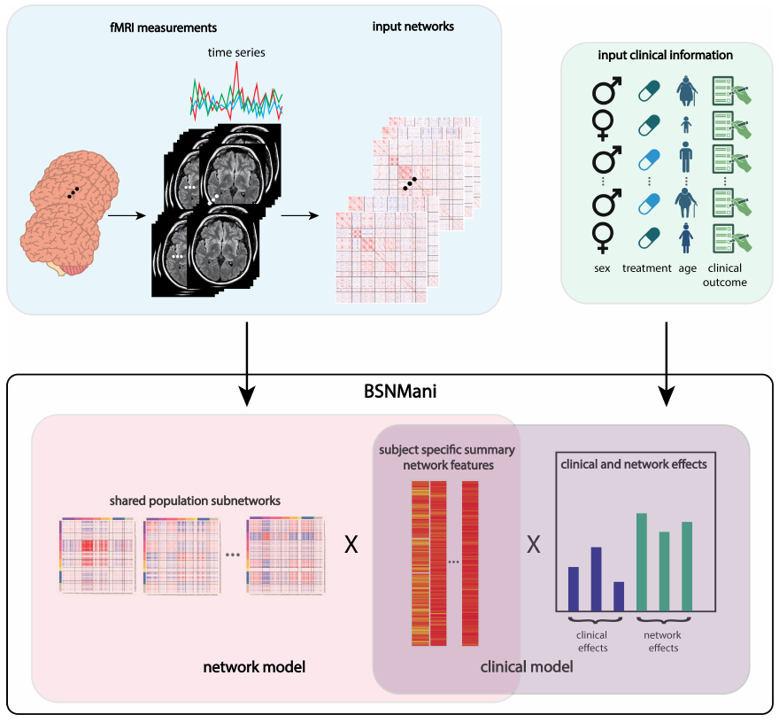
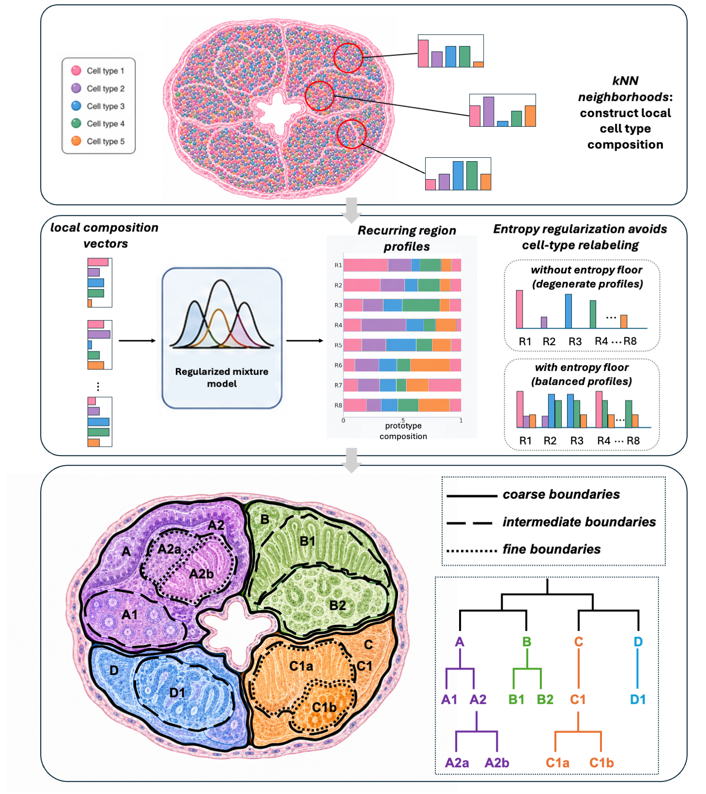
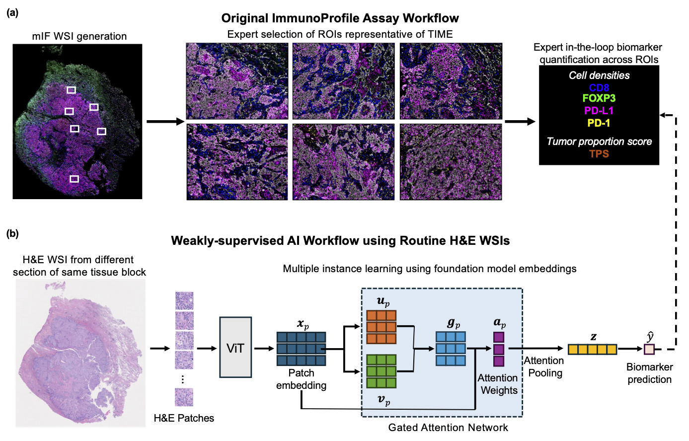

How does biological organization vary across individuals, and what can that variation tell us about disease? My research approaches this question through three complementary directions: population-level network modeling, spatial tissue architecture, and quantitative immune profiling from histopathology.

## Linking biological networks to clinical outcomes at the population level {#biological-networks}

::: {.project-label}
BSNMani · BSNMani+ · SPIN
:::

Biological networks describe relationships among components such as brain regions, genes, and proteins. Studying these networks across individuals offers opportunities to understand how differences in biological organization relate to cognitive performance, treatment response, and disease. The statistical challenge is that each individual is represented by a high-dimensional set of interdependent connections, while meaningful variation may emerge through coordinated patterns across multiple components. I develop statistical frameworks that learn shared patterns of network organization, characterize how these patterns vary across individuals, and connect that variation to clinical outcomes.

**BSNMani.** BSNMani is a Bayesian framework that jointly models biological networks and clinical outcomes. It represents each individual’s network as a weighted combination of shared subnetworks and uses these weights in an outcome regression, allowing both network structure and outcomes to guide the patterns learned. In 130 participants with major depressive disorder from the PReDICT study, it recovered four shared subnetworks spanning 454 brain regions. One connected the default mode network with the dorsal attention, salience/ventral attention, and control networks; greater baseline expression of this pattern was associated with smaller improvements in depressive symptoms after 12 weeks of treatment. The joint model incorporating network features and clinical covariates achieved better prediction than lasso and elastic net in repeated five-fold cross-validation.

**BSNMani+.** BSNMani+ extends this framework to larger cohorts by replacing strict orthogonality constraints with a probabilistic approximation. This enables simpler Gibbs sampling updates and substantially reduces computation while retaining joint modeling of networks and outcomes. Applied to 4,549 children from 16 sites in the Adolescent Brain Cognitive Development study, it identified four subnetworks and estimated their associations with general cognitive ability after adjustment for demographic covariates. Highlighted patterns connected the visual network with attention, frontoparietal, and default mode networks. Another linked the somatomotor hand network with frontoparietal, cingulo-opercular, and attention networks.

*Manuscript in submission.*

**SPIN.** SPIN adapts this framework to spatial omics, constructing patient-specific gene co-expression or protein co-abundance networks and relating shared molecular subnetworks to clinical outcomes. In 27 donors from the Seattle Alzheimer’s Disease Brain Cell Atlas, it identified gene modules enriched for synaptic signaling and neuronal development. In 253 breast cancer patients, combining SPIN-derived protein network features with clinical variables improved cross-validated survival prediction, increasing the C-index from 0.71 to 0.78. The recovered protein modules reflected distinct programs in hormone-receptor signaling and epithelial differentiation.

```{=html}
<div class="project-links">
  <a href="https://doi.org/10.1214/26-AOAS2140" target="_blank" rel="noopener">BSNMani paper ↗</a>
  <a href="https://github.com/codingpoppy/BSNMani" target="_blank" rel="noopener">BSNMani GitHub ↗</a>
  <a href="https://www.medrxiv.org/content/10.1101/2025.08.09.25333297v3" target="_blank" rel="noopener">SPIN preprint ↗</a>
  <a href="https://github.com/lanagarmire/SPIN" target="_blank" rel="noopener">SPIN software ↗</a>
</div>
<figure class="research-figure">
  <a href="assets/bsnmani-figure1.png" target="_blank" rel="noopener" aria-label="View the BSNMani overview at full size">
    
  </a>
  <figcaption>BSNMani jointly learns shared subnetworks, individual network features, and their associations with clinical outcomes. Figure 1 from <a href="https://arxiv.org/abs/2410.02965">Li et al., BSNMani</a>. Select the figure to view it at full size.</figcaption>
</figure>
```

## Multiscale tissue architecture {#tissue-architecture}

::: {.project-label}
CTMap
:::

Anatomical regions organize cellular function, yet their boundaries are often defined manually using histology and prior knowledge. **CTMap** provides a probabilistic framework for defining tissue anatomy directly from the spatial arrangement of cell types. Starting with cell identities and coordinates, the method characterizes local cellular neighborhoods and learns spatially coherent domains with interpretable cell-type composition profiles.

An entropy-regularized mixture model discourages domains from collapsing into single-cell-type labels, while a hierarchy of related domains connects broad compartments to finer subregions and localized niches. Applications to gut and brain tissues illustrate how composition-based modeling can recover layered and nuclei-like organization across anatomical scales. By treating anatomy as a quantitative, multiscale property of cellular organization, this work provides a foundation for reproducible region-based analysis and for studying how tissue structure changes across biological conditions.

*Manuscript in submission.*

```{=html}
<figure class="research-figure">
  <a href="assets/ctmap-figure1.png" target="_blank" rel="noopener" aria-label="View the CTMap overview at full size">
    
  </a>
  <figcaption>Fig. 1: CTMap (Cell-Type distribution-based Anatomical Map) constructs hierarchical multiscale tissue architecture from spatial cell-type composition profiles.</figcaption>
</figure>
```

## Immune biomarker profiling from histopathology {#computational-pathology}

::: {.project-label}
HistoProfile
:::

The tumor immune microenvironment shapes cancer progression and prognosis. Multiplex immunofluorescence (mIF) quantifies immune-cell populations and checkpoint markers, but its cost and specialized workflows motivate estimating these biomarkers from more widely available hematoxylin and eosin (H&E) slides. A central challenge is that large cohorts pairing H&E with standardized immune measurements are scarce, and these measurements often cover only selected tissue regions, requiring models to connect whole-slide morphology to immune biomarkers without measurements for individual image regions.

I developed **HistoProfile**, a weakly supervised framework that estimates immune biomarkers directly from H&E whole-slide images. It combines tissue-patch representations from the CONCH histopathology foundation model with biomarker-specific attention-based multiple-instance learning, which learns how to weight and aggregate patches into slide-level predictions. Training uses paired ImmunoProfile measurements from a DFCI pan-cancer cohort without requiring labels for individual patches. In held-out patients, HistoProfile captured variation in measured immune biomarkers and preserved the original assay’s survival stratification. In representative samples, attention maps highlighted additional regions beyond those selected for the assay, with immune infiltration consistent with measured biomarker levels. Applied independently to The Cancer Genome Atlas (TCGA), HistoProfile identified cancer-specific prognostic associations: higher estimated CD8 density was associated with longer survival in head and neck cancer but shorter survival in clear-cell renal cancer.

```{=html}
<div class="project-links"><a href="https://www.biorxiv.org/content/10.64898/2026.10.06.757083v1" target="_blank" rel="noopener">HistoProfile preprint ↗</a></div>
<figure class="research-figure">
  <a href="assets/histoprofile-figure1.png" target="_blank" rel="noopener" aria-label="View the HistoProfile overview at full size">
    
  </a>
  <figcaption>HistoProfile learns from paired H&E and multiplex-imaging measurements to estimate immune biomarkers from routine H&E slides. Figure 1 from <a href="https://www.biorxiv.org/content/10.64898/2026.10.06.757083v1">Li et al., 2026 preprint</a>. Select the figure to view it at full size.</figcaption>
</figure>
```
